# Demand Forecast and Grid Simulation

Hourly electricity demand forecasting from public data, with the forecast used as the load input of a power system study in pandapower (voltage limits, line loading, N-1 contingencies).

The forecasting part and the pipeline that connects it to the grid model are the next step and are still in progress (see [Demand forecast and pipeline](#demand-forecast-and-pipeline-in-progress)).

Before building the pipeline, I wanted to know where pandapower can be trusted. So I took the PowerWorld cases that come with Glover, Overbye & Sarma, *Power System Analysis and Design* (7th ed.), rebuilt them in pandapower, and compared every number I could read from PowerWorld or the textbook. Each comparison has a stated tolerance, and the notebook stops if a value falls outside it. When the two tools didn't agree, I tried to find out why instead of loosening the tolerance. Most of the gaps came from the two tools defining or modeling something differently, and several of them turned into rules for the pipeline.

## Highlights

**Unknown transformer windings change ground fault currents by up to 5.5×** ([Week6_ex2](Examples/Week6/Week6_ex2/Week6_ex2_analysis.ipynb))
All 14 transformers in the 37-bus fault case are entered as "Unknown", and PowerWorld leaves them out of the zero-sequence network. Public network data usually has no winding information either, so I re-ran the single line-to-ground faults under different assumptions. At 138 kV the fault current changed by up to a factor of 5.5 (ELM138 went from 5.4 to 29.9 pu), while the 69 kV buses didn't change at all under delta/grounded-wye. The share of buses that sag below 0.75 pu also moved from 16 of 37 to 19 of 37, with a different set of buses. So for this kind of data I report a range from at least two assumptions, not a single number.

**`calc_sc` returned zero ground fault current at the generator buses** ([Week6_ex1](Examples/Week6/Week6_ex1/Week6_ex1_analysis.ipynb))
On the five-bus system, PowerWorld gives 177 kA and 248 kA for a ground fault at the two generator buses, but pandapower's `calc_sc` gave 0 kA. The reason is in the source: `calc_sc` has no zero-sequence model for generators and treats every one as ungrounded. Adding a grounded-wye/delta transformer from each generator bus to an empty bus, with its zero-sequence impedance divided by the IEC transformer factor, brought the currents back to within 1e-6 of the hand calculation. Even then, the IEC result was up to 1.2% below the classical one, so it can't be assumed to be the conservative number.

**IEC 60909 is not "the classical method times 1.1"** ([Week5_ex1](Examples/Week5/Week5_ex1/Week5_ex1_analysis.ipynb))
PowerWorld and the textbook compute fault currents from the pre-fault voltage and plain impedances. `calc_sc` follows IEC 60909, so I expected its currents to be 4.76% higher (c = 1.1). Instead the difference ranged from −2.9% to +2.1% depending on the bus. The generator and network transformer correction factors (K_G and K_T) explain all of it, and a hand calculation with both factors matched `calc_sc` within 1e-6. The option `use_pre_fault_voltage=True` looked like the classical method, but it keeps K_G and came out up to 7.1% low.

**`enforce_q_lims=True` was not enough** ([Week4_ex2](Examples/Week4/Week4_ex2/Week4_ex2_analysis.ipynb))
In the 37-bus case two voltage-controlling generators sit close to each other, and pandapower parked one of them on its Mvar limit while its bus voltage was already below the setpoint. PowerWorld releases a unit in that state, pandapower doesn't. The result still converged, but voltages came out 0.01 pu low in the base case and up to 0.03 pu low after outages, which turned 8 real N-1 voltage violations into 13. A small loop that releases a unit when its voltage crosses back over the setpoint reproduced PowerWorld within about 1e-5 pu.

**A 300 km line built from per-km data is biased in one direction** ([Week3_ex1](Examples/Week3/Week3_ex1/Week3_ex1_analysis.ipynb))
PowerWorld stores long lines as the exact equivalent π. If the same line is built in pandapower from per-km constants and a length, it becomes a nominal π: too much series reactance and too little charging. At 300 km and surge impedance loading that costs 0.55° of angle, 19 Mvar and 3.9% more losses. The error grows with the square of the length, and at 800 km the nominal π can't even carry the surge impedance loading. Lines longer than about 150 km now go in as an equivalent π.

## Rules carried into the pipeline

- Overload is judged on current (`loading_percent`), not MVA. The two differ by 1/max(V), about 5% when a line sits at 0.95 pu. ([Week1_ex2](Examples/Week1/Week1_ex2/Week1_ex2_analysis.ipynb))
- Voltage KPIs use energized buses only, because isolated buses come back as NaN in pandapower and 0.01 pu in PowerWorld. ([Week1_ex1](Examples/Week1/Week1_ex1))
- Capacitor banks are constant-impedance shunts (`create_shunt`), never fixed-Q generators. A fixed-Q model overstated the collapse margin by 16%. ([Week1_ex3](Examples/Week1/Week1_ex3/Week1_ex3_analysis.ipynb))
- The MVA base is read from every case. Chapter 1 used 100 MVA and Chapters 3 and 5 used 500 MVA, and a wrong base still converges.
- Every power flow uses the Mvar-limit release loop and reports which controls were frozen. ([Week4_ex2](Examples/Week4/Week4_ex2/Week4_ex2_analysis.ipynb))
- For breaker duty, run both `calc_sc` and a hand-built bus impedance matrix with loads included, and take the larger current. ([Week5_ex1](Examples/Week5/Week5_ex1/Week5_ex1_analysis.ipynb), [Week5_ex2](Examples/Week5/Week5_ex2/Week5_ex2_analysis.ipynb))
- A static N-1 result says nothing about transient stability. In Week7_ex1 the post-fault power flow converged the same way whether the fault was cleared at 0.34 s (stable) or 0.345 s (loses synchronism).

## Environment and tool limits

- pandapower 3.5.5 (pinned), Python 3.11, numpy, pandas, scipy, matplotlib, Jupyter
- PowerWorld Simulator 24 (GSO student version, 42-bus limit)

The tools shaped the work in a few ways:

- **No SimAuto in the student version.** PowerWorld can't be driven from Python, so every reference value was read from the GUI (Model Explorer tables, fault and transient stability dialogs) and typed into the notebook. Larger cases were saved as auxiliary files and the values were copied into small `case*.py` modules next to the notebooks. The PowerWorld case files themselves are not in this repository.
- **42-bus limit.** Example 6.19 doesn't open in the student version, so it was left out.
- **No time-domain solver in pandapower.** For transient stability (Week7_ex1), pandapower provides the power flow and the network admittances, and the swing equation is integrated with SciPy.
- **No distance relay in pandapower.** Its protection module has fuses and overcurrent relays only, so the distance relay in Week7_ex2 is implemented by hand.
- **`calc_sc` branch results.** When transformer taps are folded into the rated voltages (as in the 37-bus case), `calc_sc` warns that it doesn't support fault voltages and branch results. Those come from a hand-built sequence bus impedance matrix instead.

## How the repository is organized

```
Examples/
└── WeekN/
    └── WeekN_exM/
        ├── WeekN_exM.ipynb            rebuilds the case in pandapower and compares it (outputs kept)
        ├── WeekN_exM_analysis.ipynb   tests why a result differs, with hypotheses (only when needed)
        ├── case*.py, fault*.py        case data and helpers shared by the notebooks in the folder
        └── Images/                    PowerWorld one-line and plots
Projects/                              demand forecast and pipeline (in progress)
```

Each notebook names the textbook example it reproduces in its first cell. Week numbers don't match chapter numbers.

The comparison tables have a `Tolerance` and a `Source` column. The tolerance is half of the last digit PowerWorld or the textbook prints, plus how far the value can move inside PowerWorld's own convergence tolerance (0.1 or 0.5 MVA, depending on the case). That second part is computed, not chosen: every bus gets a small mismatch of that size in turn, and the changes are added up.

## Exercises

**Check types**
- *Reproduced*: every compared value is within its tolerance of PowerWorld or the textbook.
- *Deep dive*: something didn't match or needed explaining, so a separate analysis notebook tests hypotheses against it.
- *Light check*: only part of the result can be compared, because pandapower can't do the rest (dynamics, distance relays).

### Week 1 – Power flow basics and power factor correction

| | Exercise | Check | Result |
|---|---|---|---|
| 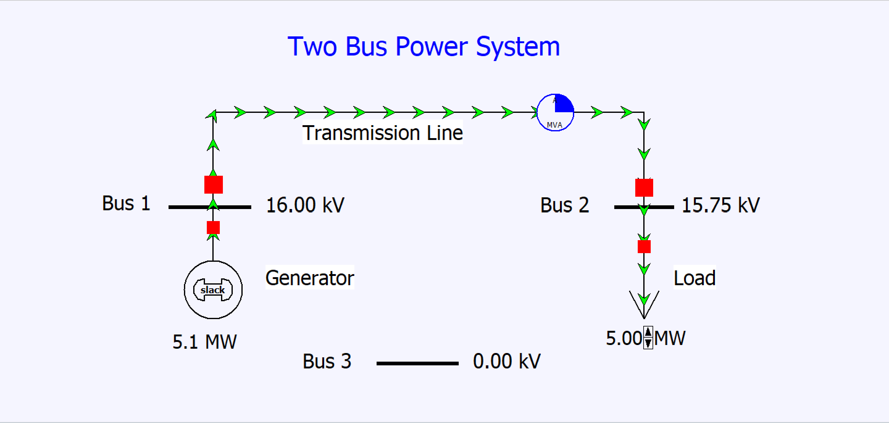 | [Week1_ex1](Examples/Week1/Week1_ex1) Two-bus system with an isolated bus (Examples 1.1, 1.2) | Reproduced | Bus 2 at 0.98430 pu / −1.75°. PowerWorld keeps the dead bus at 0.01 pu, pandapower drops it and returns NaN. |
| 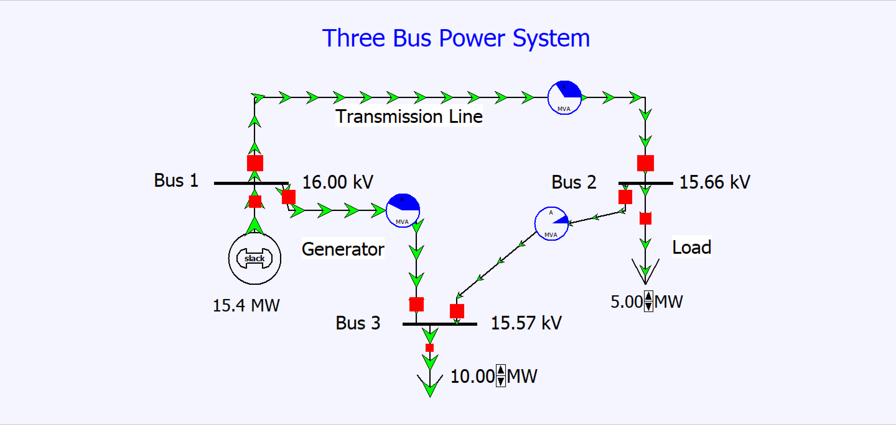 | [Week1_ex2](Examples/Week1/Week1_ex2) Three-bus meshed system (Example 1.3) | Reproduced, [Deep dive](Examples/Week1/Week1_ex2/Week1_ex2_analysis.ipynb) | All flows match. Line 2-3 loading is 8.4% vs 8.61% because one tool uses MVA and the other current. |
| 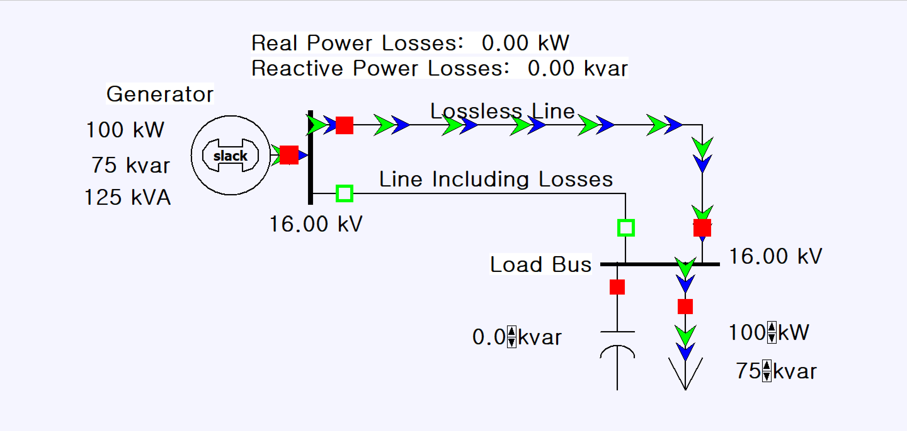 | [Week1_ex3](Examples/Week1/Week1_ex3) Power factor correction with a shunt capacitor (Example 2.3) | Reproduced, [Deep dive](Examples/Week1/Week1_ex3/Week1_ex3_analysis.ipynb) | Losses drop from 10.81 to 5.73 kW. The 80 kvar bank gives 70.0 kvar at 0.936 pu, so its output follows V². |

### Week 2 – Transformers

| | Exercise | Check | Result |
|---|---|---|---|
| 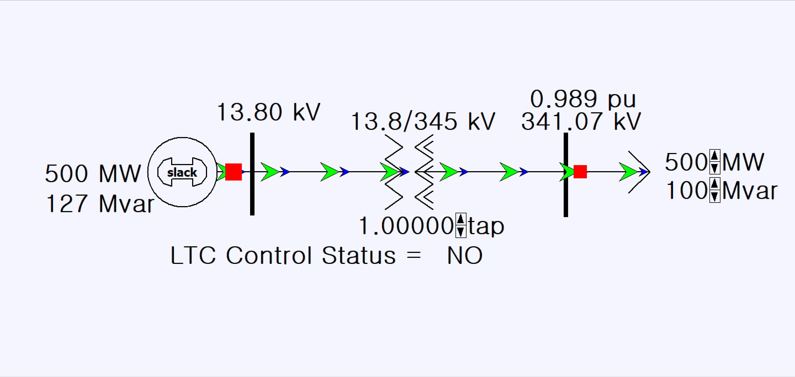 | [Week2_ex1](Examples/Week2/Week2_ex1) Off-nominal tap (Example 3.12) | Reproduced | 341.07 kV at tap 1.00 and 358.12 kV at 1.05. PowerWorld's tap sits on the From side, so `hv_bus` = From and `tap_side="hv"`. |
| 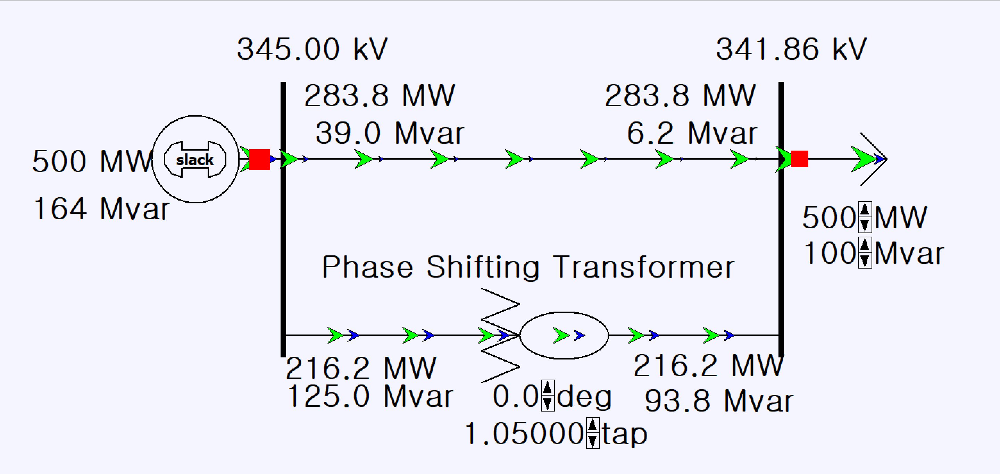 | [Week2_ex2](Examples/Week2/Week2_ex2) Phase-shifting transformer in a parallel path (Example 3.13, Problems 3.60–3.61) | Reproduced | Asymmetric Ybus and flows at 0° and +10° match. On a 345/345 kV shifter, swapping hv and lv flips the sign of the angle without any error. |
| 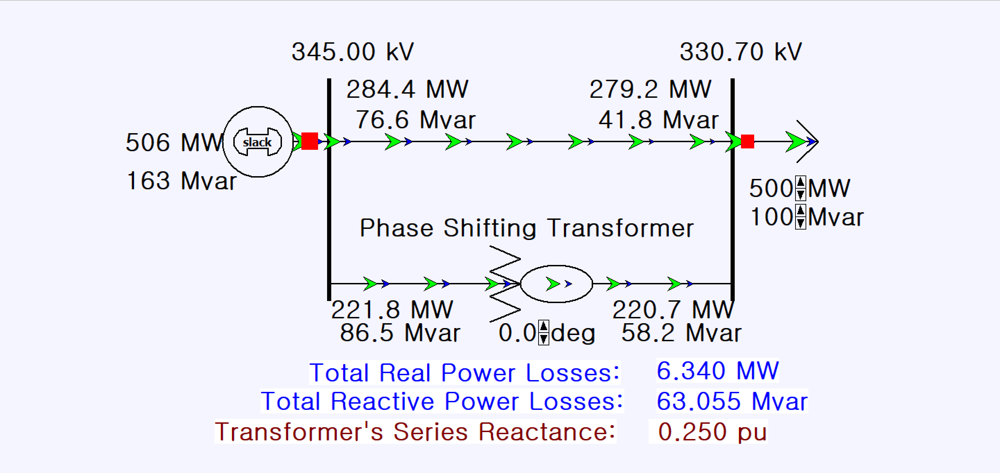 | [Week2_ex3](Examples/Week2/Week2_ex3) Angle-dependent shifter impedance (Problem 3.62) | Reproduced, [Deep dive](Examples/Week2/Week2_ex3/Week2_ex3_analysis.ipynb) | The correction table scales R and X together. Scaling only X understates losses by 16% at +10° and 43% at +30°. |

### Week 3 – Long transmission lines

| | Exercise | Check | Result |
|---|---|---|---|
| 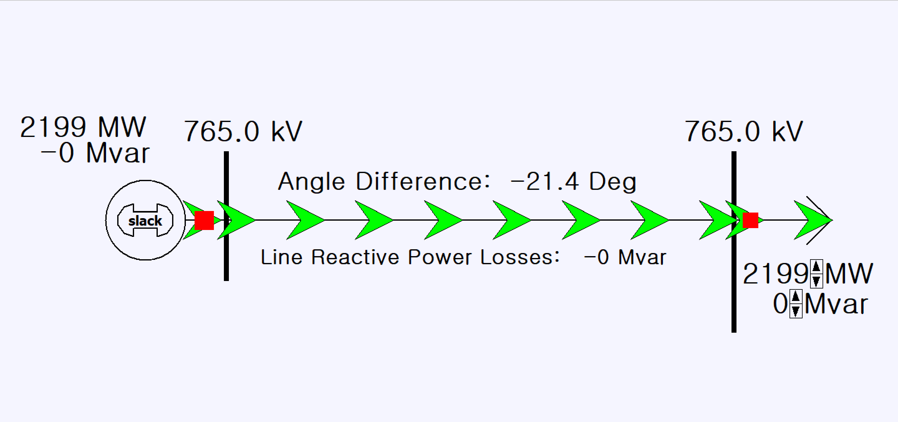 | [Week3_ex1](Examples/Week3/Week3_ex1) Surge impedance loading of a 300 km, 765 kV line (Example 5.4) | Reproduced, [Deep dive](Examples/Week3/Week3_ex1/Week3_ex1_analysis.ipynb) | Matches at 1500, 2199 and 2999 MW. A nominal π adds 0.55° and 19 Mvar at SIL, and the error grows with length². |
| 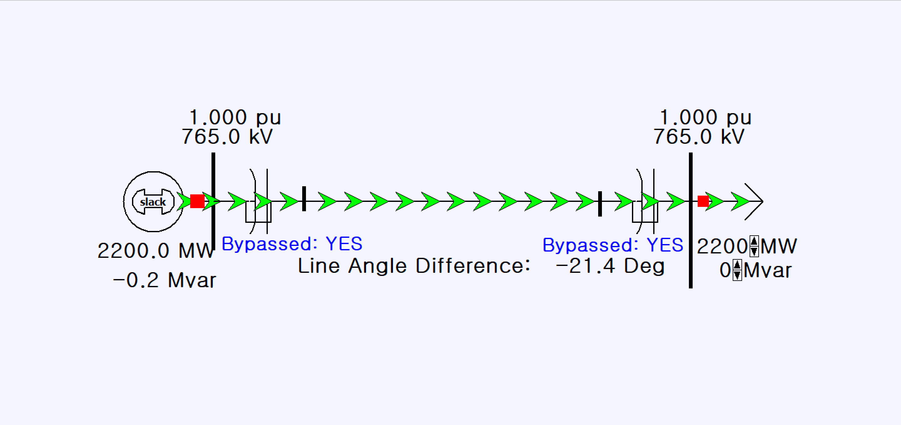 | [Week3_ex2](Examples/Week3/Week3_ex2) Series capacitor compensation (Example 5.10) | Reproduced | With the capacitors in, 3000 MW flows at the same angle (−21.36°) as 2200 MW without them. A bypassed capacitor is not an out-of-service one. |

### Week 4 – Power flow and contingency analysis

| | Exercise | Check | Result |
|---|---|---|---|
| 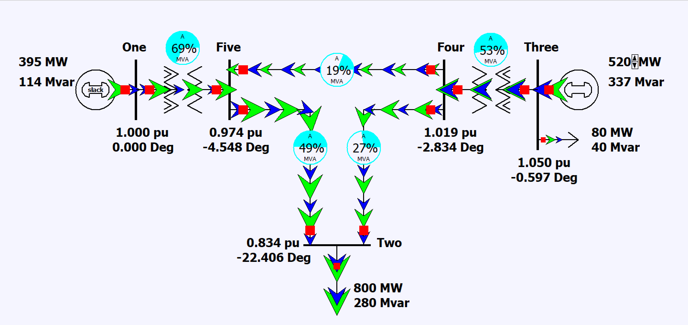 | [Week4_ex1](Examples/Week4/Week4_ex1) Five-bus power flow (Examples 6.9–6.12, 6.14, 6.17) | Reproduced | Ybus, one Gauss-Seidel and one Newton-Raphson step, the generator 3 range, the 200 Mvar capacitor and the DC flow all match. |
| 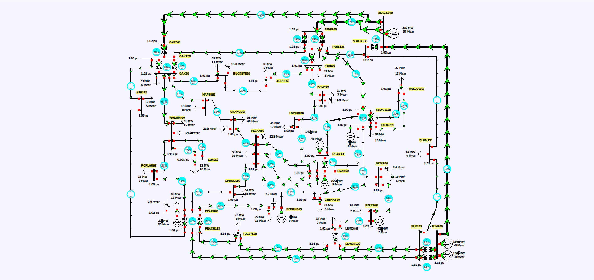 | [Week4_ex2](Examples/Week4/Week4_ex2) 37-bus system, N-1, sensitivities, economic dispatch (Examples 6.13, 6.15, 6.16, Problems 6.52–6.54) | Reproduced, [Deep dive](Examples/Week4/Week4_ex2/Week4_ex2_analysis.ipynb) | All 57 outages give the same violations as PowerWorld's contingency analysis. The worst one is not the outage the textbook discusses. |
| 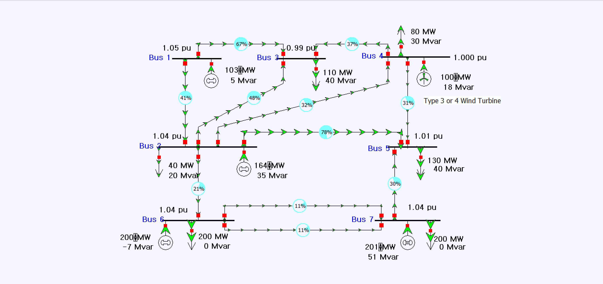 | [Week4_ex3](Examples/Week4/Week4_ex3) Wind plant models (Problem 6.61) | Reproduced | After line 2-4 opens, the fixed power factor model drops bus 4 to 0.973 pu, and the voltage-control model holds 1.000 pu. |
| 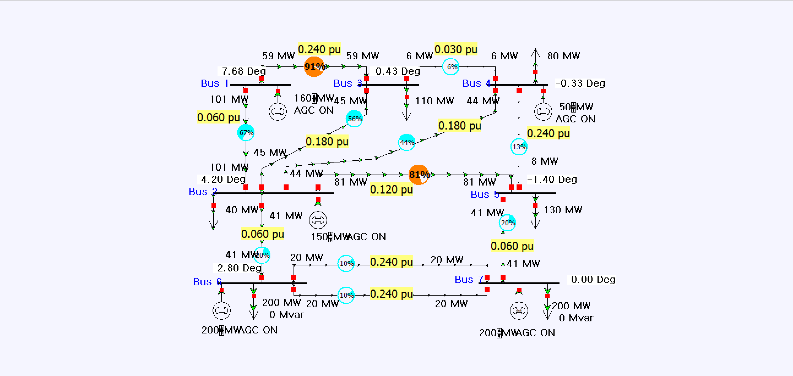 | [Week4_ex4](Examples/Week4/Week4_ex4) DC power flow, PTDF and LODF (Problems 6.59, 6.60) | Reproduced | LODF agrees with a DC re-solve to 3e-13 MW. AC current loading runs up to 7.2 points above DC, so a DC screen should flag from about 93%. |

### Week 5 – Balanced faults

| | Exercise | Check | Result |
|---|---|---|---|
| 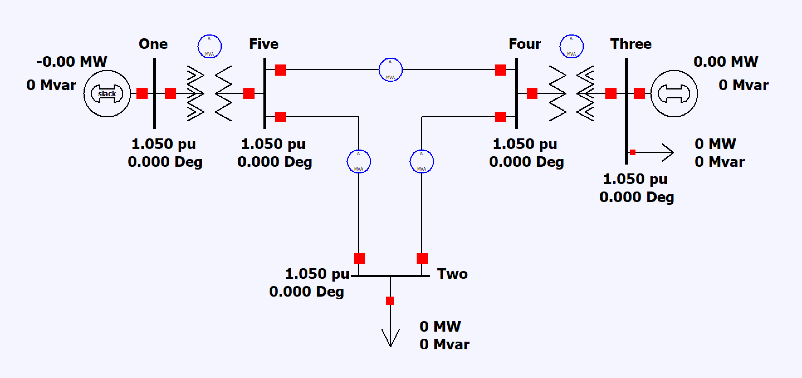 | [Week5_ex1](Examples/Week5/Week5_ex1) Three-phase faults on a five-bus system (Example 8.5) | Reproduced, [Deep dive](Examples/Week5/Week5_ex1/Week5_ex1_analysis.ipynb) | The bus impedance matrix with X″ matches PowerWorld. `calc_sc` is −2.9% to +2.1% off, all from the IEC correction factors. |
| 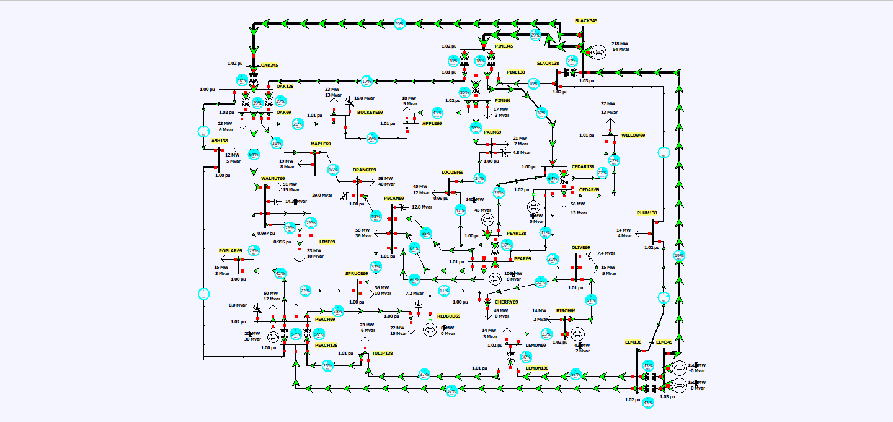 | [Week5_ex2](Examples/Week5/Week5_ex2) Three-phase faults on the loaded 37-bus system (Problem 8.28) | Reproduced, [Deep dive](Examples/Week5/Week5_ex2/Week5_ex2_analysis.ipynb) | 148 values match only with the loads kept as admittances. Without them every fault current drops, by up to 5.3%. |

### Week 6 – Unbalanced faults

| | Exercise | Check | Result |
|---|---|---|---|
| 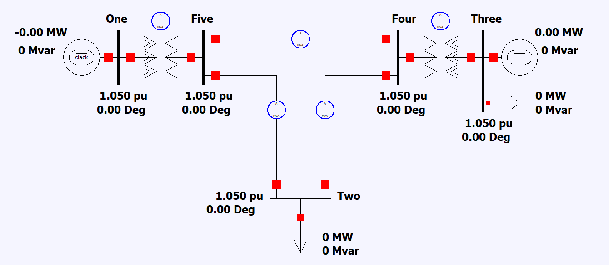 | [Week6_ex1](Examples/Week6/Week6_ex1) Single line-to-ground faults on a five-bus system (Example 10.8) | Reproduced, [Deep dive](Examples/Week6/Week6_ex1/Week6_ex1_analysis.ipynb) | Sequence networks match PowerWorld. `calc_sc` gives 0 kA at the generator buses until a grounding bank is added. |
| 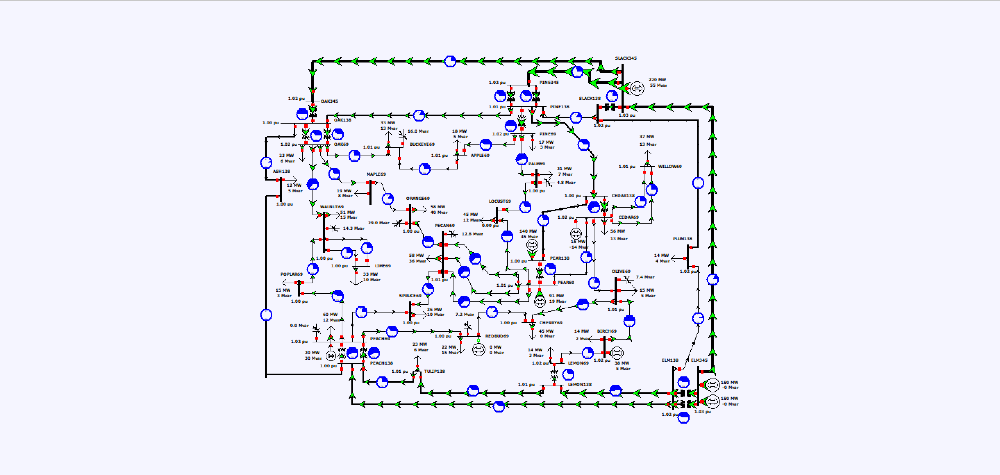 | [Week6_ex2](Examples/Week6/Week6_ex2) Single line-to-ground faults on the 37-bus system (Problem 10.64) | Reproduced, [Deep dive](Examples/Week6/Week6_ex2/Week6_ex2_analysis.ipynb) | 532 values match. 16 of 37 buses sag below 0.75 pu. The winding assumption changes 138 kV currents by up to 5.5×. |

### Week 7 – Transient stability and protection

| | Exercise | Check | Result |
|---|---|---|---|
| 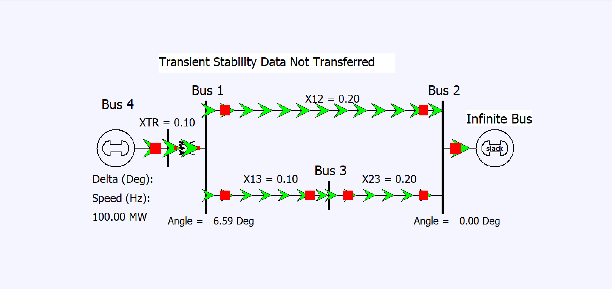 | [Week7_ex1](Examples/Week7/Week7_ex1) Generator on an infinite bus (Examples 12.3–12.8) | Light check | Critical clearing time 0.343 s. PowerWorld is stable at 0.34 s and loses synchronism at 0.345 s. Its 144.70° peak (vs 143.30°) comes from its fixed integration step. |
|  | [Week7_ex2](Examples/Week7/Week7_ex2) Distance and overcurrent relays on the 37-bus system (not a textbook example) | Light check | Strong infeed at ELM138 lets zone 3 reach only 5–25% of the next line. Non-directional overcurrent relays in the 138 kV ring trip a healthy line as fast as the faulted one. |

## Demand forecast and pipeline (in progress)

The plan for this part:

1. Hourly demand from the Korea Power Exchange (KPX) and weather from the Korea Meteorological Administration, joined on time.
2. Gradient-boosted tree models (XGBoost, LightGBM) with a time-ordered train/test split, compared against a seasonal naive baseline.
3. The forecast total split over the buses of the grid model and run through pandapower as a time series, with hours of voltage violation per bus, line loading, and N-1 under peak conditions.

The grid side will use a model of the Korean transmission network that I'm building from public data (OpenStreetMap lines and substations, KPX generator data). The operator's own model isn't public, so the README will describe how the model was built and how it was checked. This section will be filled in as the work is done.

## Running the notebooks

1. Create a Python 3.11 environment and install the pinned packages: `pip install -r requirements.txt`
2. Open a notebook and run it top to bottom. Notebooks that use a `case*.py` module import it from their own folder, so run them from there.

PowerWorld is not needed to run anything, because the reference values are already in the notebooks. Week4_ex2 is the slowest and takes about five minutes.